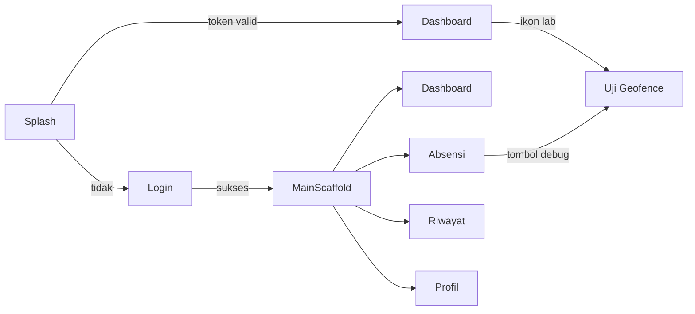
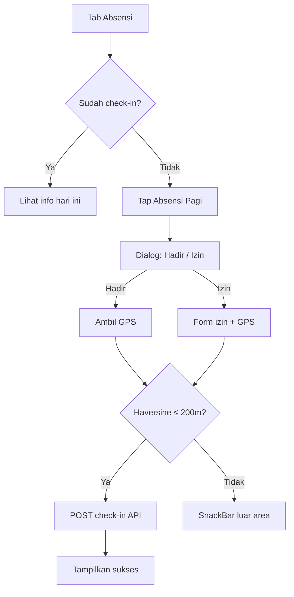

# WIREFRAME APLIKASI ABSENSI KJAVJM

Dokumen wireframe (*low-fidelity*) untuk skripsi — diselaraskan dengan implementasi aktual pada proyek `kjavjm_mobile_app`.

**Platform:** Mobile Android (portrait)  
**Resolusi acuan:** 360 × 800 dp  
**Navigasi utama:** Bottom Navigation (4 tab)

---

## Daftar Wireframe


| No    | Layar                  | File kode acuan                                                      |
| ----- | ---------------------- | -------------------------------------------------------------------- |
| WF-01 | Splash                 | `lib/splash_page.dart`                                               |
| WF-02 | Login                  | `lib/features/auth/presentation/pages/login_page.dart`               |
| WF-03 | Dashboard (Home)       | `lib/features/dashboard/presentation/pages/dashboard_page.dart`      |
| WF-04 | Absensi                | `lib/features/attendance/presentation/pages/attendance_page.dart`    |
| WF-05 | Dialog Check-in        | `attendance_page.dart`                                               |
| WF-06 | Dialog Luar Area       | `attendance_page.dart`                                               |
| WF-07 | Riwayat Absensi        | `lib/features/attendance/presentation/pages/history_page.dart`       |
| WF-08 | Profil                 | `lib/features/profile/presentation/pages/profile_page.dart`          |
| WF-09 | Uji Geofence           | `lib/features/geofencing/presentation/pages/geofence_test_page.dart` |
| WF-10 | Peta Navigasi Aplikasi | `lib/main.dart`, `main_scaffold.dart`                                |


---

## WF-10 — Peta Navigasi Aplikasi




---

## WF-01 — Splash Screen

```
┌──────────────────────────────────────┐
│ ░░░░░░░░░░░░░░░░░░░░░░░░░░░░░░░░░░░░ │  ← Status bar
│                                      │
│                                      │
│                                      │
│            ┌────────────┐            │
│            │            │            │
│            │   [LOGO]   │            │  ← App icon 100×100
│            │   KJAVJM   │            │
│            └────────────┘            │
│                                      │
│         Absensi KJAVJM               │
│                                      │
│            ◠ ◡ ◠                     │  ← Loading indicator
│                                      │
│                                      │
│                                      │
└──────────────────────────────────────┘
```

**Elemen:** Logo aplikasi, nama app, indikator loading, cek token → arahkan ke Login atau Dashboard.

---

## WF-02 — Login

```
┌──────────────────────────────────────┐
│ ░░░░░░░░░░░░░░░░░░░░░░░░░░░░░░░░░░░░ │
│                          ○ decor     │
│                                      │
│            ┌────────────┐            │
│            │  💼 icon   │            │
│            └────────────┘            │
│                                      │
│          Welcome Back                │
│   Sign in to access your dashboard   │
│                                      │
│  ┌────────────────────────────────┐  │
│  │ 📧  Email                      │  │
│  └────────────────────────────────┘  │
│  ┌────────────────────────────────┐  │
│  │ 🔒  Password              👁   │  │
│  └────────────────────────────────┘  │
│                                      │
│  ┌────────────────────────────────┐  │
│  │         LOGIN / MASUK            │  │  ← Primary button (biru)
│  └────────────────────────────────┘  │
│                                      │
│         ○ decor                      │
└──────────────────────────────────────┘
```

**Elemen:** Logo, judul, field email, field password, tombol login. Background gradient abu-biru muda.

---

## WF-03 — Dashboard (Home)

```
┌──────────────────────────────────────┐
│ Dashboard          🔬  🔄  🚪       │  ← Header biru (uji geofence, refresh, logout)
├──────────────────────────────────────┤
│ ╭──────────────────────────────────╮ │
│ │  👤  Halo, [Nama User]           │ │  ← Dashboard header / greeting
│ │      [Departemen]                │ │
│ ╰──────────────────────────────────╯ │
│                                      │
│ ╭──────── Status Hari Ini ─────────╮ │
│ │  Check-in:  08:05   ✓ Hadir      │ │
│ │  Check-out: --:--                │ │
│ ╰──────────────────────────────────╯ │
│                                      │
│ ╭──── Ringkasan Bulan Ini ─────────╮ │
│ │  Hadir │ Telat │ Izin │ Absen   │ │
│ │   18   │   2   │   1  │   0     │ │
│ ╰──────────────────────────────────╯ │
│                                      │
│ ╭──── Log Absensi Terbaru ─────────╮ │
│ │  • 04/06  Hadir    08:05-17:00   │ │
│ │  • 03/06  Telat    08:22-17:05   │ │
│ │  • 02/06  Hadir    07:58-17:00   │ │
│ ╰──────────────────────────────────╯ │
│                                      │
├──────────────────────────────────────┤
│  🏠 Home  │ ⏰ Absensi │ 📋 Riwayat │ 👤 Profil │
└──────────────────────────────────────┘
```

**Elemen:** Header dengan aksi, kartu sapaan, status hari ini, ringkasan statistik, daftar log. Bottom nav tab **Home** aktif.

---

## WF-04 — Halaman Absensi

```
┌──────────────────────────────────────┐
│ ░░░░░░░░░░░  Absensi  ░░░░░░░░░░░░░░ │  ← AppBar biru
├──────────────────────────────────────┤
│                                      │
│ ╭──── Info Pengguna ───────────────╮ │
│ │  (○)  [Nama User]                │ │
│ │       [Foto profil]              │ │
│ ╰──────────────────────────────────╯ │
│                                      │
│ ╭──── Absensi Hari Ini ────────────╮ │  ← Jika sudah check-in
│ │  ℹ Check-in: 08:05               │ │
│ │  📍 Jl. Menteng Raya, Jakarta    │ │
│ │  Status: Hadir                   │ │
│ ╰──────────────────────────────────╯ │
│                                      │
│ ╭──── Absensi Pagi ────────────────╮ │
│ │  ☀  Jam masuk: 08:00             │ │
│ │     [ Tap untuk absen masuk ] →  │ │  ← AttendanceActionCard
│ ╰──────────────────────────────────╯ │
│                                      │
│ ╭──── Absensi Pulang ──────────────╮ │
│ │  🌙  Jam pulang: 17:00             │ │
│ │     [ Tap untuk absen pulang ] → │ │
│ ╰──────────────────────────────────╯ │
│                                      │
│ ╭──── Data Lembur ─────────────────╮ │
│ │  ⏰  Mulai lembur: 18:00          │ │
│ ╰──────────────────────────────────╯ │
│                                      │
│  Riwayat Absensi Terakhir            │
│  ┌──────────────────────────────┐   │
│  │ 03/06  Hadir  08:00-17:00    │   │
│  └──────────────────────────────┘   │
│                                      │
│  ┌──────────────────────────────┐   │
│  │ 🔬 Uji Akurasi Geofence      │   │  ← Tombol ke halaman uji
│  └──────────────────────────────┘   │
│                                      │
├──────────────────────────────────────┤
│  🏠 Home  │ ⏰ Absensi │ 📋 Riwayat │ 👤 Profil │
└──────────────────────────────────────┘
         ↑ tab Absensi aktif
```

**Elemen:** Kartu user, info absensi hari ini, 3 kartu aksi (pagi/pulang/lembur), riwayat singkat, tombol uji geofence.

---

## WF-05 — Dialog Check-in

```
┌──────────────────────────────────────┐
│ ░░░░░░░░░░ (layar absensi redup) ░░░ │
│         ┌────────────────────┐       │
│         │ Pilih Status         │       │
│         │ Kehadiran            │       │
│         ├────────────────────┤       │
│         │ ✓  Hadir             │       │
│         │    (atau Terlambat)  │       │
│         ├────────────────────┤       │
│         │ 🏥  Izin             │       │
│         └────────────────────┘       │
│                                      │
└──────────────────────────────────────┘

        ↓ setelah pilih Hadir

┌──────────────────────────────────────┐
│         ┌────────────────────┐       │
│         │   ◠ Loading GPS      │       │
│         │ Mengambil lokasi...  │       │
│         └────────────────────┘       │
└──────────────────────────────────────┘

        ↓ jika lolos geofence

┌──────────────────────────────────────┐
│         ┌────────────────────┐       │
│         │ Keterangan Terlambat │       │  ← Hanya jika terlambat
│         │ ┌────────────────┐ │       │
│         │ │ alasan...      │ │       │
│         │ └────────────────┘ │       │
│         │ [Batal]    [Kirim] │       │
│         └────────────────────┘       │
└──────────────────────────────────────┘
```

---

## WF-06 — SnackBar / Pesan Luar Area Geofence

```
┌──────────────────────────────────────┐
│ ░░░░░░░░░░  Absensi  ░░░░░░░░░░░░░░░ │
│                                      │
│   (kartu absensi — disabled / abu)   │
│                                      │
│                                      │
│ ╭──────────────────────────────────╮ │
│ │ ⛔ Anda berada di luar area      │ │  ← SnackBar merah (floating)
│ │    Mercu Buana Menteng           │ │
│ │    (jarak 332 m)                 │ │
│ ╰──────────────────────────────────╯ │
│                                      │
├──────────────────────────────────────┤
│  🏠 Home  │ ⏰ Absensi │ 📋 Riwayat │ 👤 Profil │
└──────────────────────────────────────┘
```

**Catatan skripsi:** Wireframe ini merepresentasikan pembatasan geofence Haversine radius 200 m.

---

## WF-07 — Riwayat Absensi

```
┌──────────────────────────────────────┐
│ ░░░░░░░░░░░░░░░░░░░░░░░░░░░░  🔄    │
│         Riwayat Absensi              │  ← SliverAppBar gradient biru
├──────────────────────────────────────┤
│                                      │
│ ╭──── Statistik Tahun ─────────────╮ │
│ │  [Grafik / kartu statistik]      │ │
│ │  Hadir: 180  Telat: 12  Izin: 8  │ │
│ ╰──────────────────────────────────╯ │
│                                      │
│ ╭──── Filter ──────────────────────╮ │
│ │  Bulan: [Juni 2026 ▼]  Status ▼  │ │
│ ╰──────────────────────────────────╯ │
│                                      │
│ ╭──────────────────────────────────╮ │
│ │ 04 Jun 2026   ✓ Hadir            │ │
│ │ Masuk 08:05  ·  Pulang 17:02     │ │
│ │ 📍 Mercu Buana Menteng           │ │
│ ╰──────────────────────────────────╯ │
│ ╭──────────────────────────────────╮ │
│ │ 03 Jun 2026   ⚠ Terlambat        │ │
│ │ Masuk 08:22  ·  Pulang 17:00     │ │
│ ╰──────────────────────────────────╯ │
│ ╭──────────────────────────────────╮ │
│ │ 02 Jun 2026   ✓ Hadir            │ │
│ ╰──────────────────────────────────╯ │
│                                      │
├──────────────────────────────────────┤
│  🏠 Home  │ ⏰ Absensi │ 📋 Riwayat │ 👤 Profil │
└──────────────────────────────────────┘
```

---

## WF-08 — Profil

```
┌──────────────────────────────────────┐
│ ░░░░░░░░░░░░░░░░░░░░░░░░░░░░░░░░░░░░ │
│         ╭─────────────────╮          │
│         │    ( Foto )     │          │  ← Header profil
│         │   [Nama User]   │          │
│         │  user@email.com │          │
│         │  [Departemen]   │          │
│         ╰─────────────────╯          │
│                                      │
│ ╭──── Statistik ───────────────────╮ │
│ │  Hadir │ Izin │ Absen bulan ini  │ │
│ ╰──────────────────────────────────╯ │
│                                      │
│ ╭──── Data Profil ─────────────────╮ │
│ │  Nama     [_______________]      │ │
│ │  Telepon  [_______________]      │ │
│ │  Alamat   [_______________]      │ │
│ │  Kota     [_______________]      │ │
│ │         [ Simpan Perubahan ]     │ │
│ ╰──────────────────────────────────╯ │
│                                      │
│ ╭──── Keamanan ────────────────────╮ │
│ │  🔒  Ubah Password               │ │
│ │  🚪  Logout                      │ │
│ ╰──────────────────────────────────╯ │
│                                      │
├──────────────────────────────────────┤
│  🏠 Home  │ ⏰ Absensi │ 📋 Riwayat │ 👤 Profil │
└──────────────────────────────────────┘
```

---

## WF-09 — Uji Geofence (Skripsi / Lapangan)

```
┌──────────────────────────────────────┐
│ ←  Uji Geofence Mercu Buana          │  ← AppBar
├──────────────────────────────────────┤
│ ╭──── Konfigurasi Area ────────────╮ │
│ │ Mercu Buana Menteng              │ │
│ │ Pusat: -6.1856, 106.8364         │ │
│ │ Radius: 200 m                    │ │
│ │ Metode aktif: M1 (Haversine)     │ │
│ ╰──────────────────────────────────╯ │
│                                      │
│ ╭──── Kontrol Uji ─────────────────╮ │
│ │ Titik uji:  [T1 — Dalam jelas ▼] │ │
│ │ Metode:     [M1 — Haversine   ▼] │ │
│ │ [Salin 1 baris] [Salin semua]    │ │
│ ╰──────────────────────────────────╯ │
│                                      │
│ ╭──── Hasil Terakhir ──────────────╮ │
│ │  INSIDE  ✓ Sesuai ground truth   │ │  ← Hijau = benar
│ │  Jarak: 48 m                     │ │
│ │  Lat: -6.185150  Lng: 106.836400 │ │
│ ╰──────────────────────────────────╯ │
│        — atau —                      │
│ ╭──────────────────────────────────╮ │
│ │  OUTSIDE  ✗ Tidak sesuai         │ │  ← Merah = salah
│ │  Jarak: 220 m                    │ │
│ ╰──────────────────────────────────╯ │
│                                      │
│ ╭──── Titik Referensi T1–T5 ───────╮ │
│ │  T1 Dalam jelas      [Simulasi]  │ │
│ │  T2 Tepi dalam       [Simulasi]  │ │
│ │  T3 Tepi luar        [Simulasi]  │ │
│ │  ...                             │ │
│ ╰──────────────────────────────────╯ │
│                                      │
│ ╭──── Log Sampel (50 max) ─────────╮ │
│ │ M1_T1_1  INSIDE  48m  ✓        │ │
│ │ M1_T1_2  OUTSIDE 220m  ✗        │ │
│ ╰──────────────────────────────────╯ │
│                                      │
│              ┌──────────────────┐   │
│              │ 📍 Ambil Lokasi  │   │  ← FAB biru
│              └──────────────────┘   │
└──────────────────────────────────────┘
```

---

## WF-11 — Bottom Navigation (Komponen Bersama)

```
┌──────────────────────────────────────┐
│                                      │
│           (konten halaman)           │
│                                      │
├──────────────────────────────────────┤
│   🏠        ⏰         📋        👤   │
│  Home    Absensi    Riwayat   Profil  │
│  ────                                │  ← Indikator tab aktif (biru)
└──────────────────────────────────────┘
```


| Tab     | Index | Ikon          | Halaman        |
| ------- | ----- | ------------- | -------------- |
| Home    | 0     | `home`        | DashboardPage  |
| Absensi | 1     | `access_time` | AttendancePage |
| Riwayat | 2     | `history`     | HistoryPage    |
| Profil  | 3     | `person`      | ProfilePage    |


---

## WF-12 — User Flow Wireframe (Absensi + Geofence)




---

## Legenda Wireframe


| Simbol      | Arti                                |
| ----------- | ----------------------------------- |
| `┌─┐ │ ╰─╯` | Bingkai layar / kartu               |
| `░░░`       | Status bar / AppBar                 |
| `[...]`     | Input field / tombol                |
| `(○)`       | Avatar / foto                       |
| `→`         | Aksi tap / navigasi                 |
| `▼`         | Dropdown                            |
| `✓` / `✗`   | Status benar / salah (uji geofence) |
| `╭─╮`       | Card dengan sudut membulat          |


---

## Cara Memasukkan ke Skripsi (Bab 3)

1. **Screenshot wireframe ASCII** — copy blok wireframe ke Word dengan font **Courier New** / **Consolas** ukuran 9–10 pt.
2. **Export visual** — gunakan tool seperti Figma, draw.io, atau [wireframe.cc](https://wireframe.cc) mengacu layout di dokumen ini.
3. **Penomoran gambar** — contoh: *Gambar 3.12 Wireframe Halaman Absensi*, *Gambar 3.13 Wireframe Uji Geofence*.
4. **Letakkan di sub-bab** 3.2 Desain Penelitian → *Perancangan Antarmuka Pengguna (UI)*.

---

## Checklist Wireframe untuk Skripsi

- WF-02 Login
- WF-03 Dashboard
- WF-04 Absensi
- WF-06 Pesan luar area (geofence)
- WF-09 Uji Geofence
- WF-10 Peta navigasi
- WF-12 User flow absensi

---

*Dokumen: `docs/WIREFRAME_APLIKASI.md` — wireframe low-fidelity aplikasi KJAVJM HR Mobile App.*